[artifice.cloud](https://artifice.cloud) &nbsp;·&nbsp;
[instagram](https://www.instagram.com/andreacacioppo_/) &nbsp;·&nbsp;
[linkedin](https://www.linkedin.com/in/andrea-cacioppo1/) &nbsp;·&nbsp;
[email](mailto:andreacacioppo04@gmail.com)

> AI engineer and software developer based in Italy. 
> I build agentic systems and developer tools.

Right now I'm focused on [adobe-indesign-mcp](https://github.com/nutriandrea/adobe-indesign-mcp), an MCP server for programmatic control of Adobe InDesign, and exploring [ALP](https://github.com/nutriandrea/alp), an experimental format for structured learning pathways for AI agents.

<samp>typescript &nbsp; python &nbsp; react &nbsp; java &nbsp; c &nbsp; fastapi &nbsp; supabase &nbsp; vite &nbsp; vhdl</samp>

**[adobe-indesign-mcp](https://github.com/nutriandrea/adobe-indesign-mcp)** &nbsp;·&nbsp; <samp>typescript, uxp</samp> 
MCP server for Adobe InDesign with broad DOM coverage for 
document creation, editing, and export workflows.

**[alp](https://github.com/nutriandrea/alp)** &nbsp;·&nbsp; <samp>python, spec draft</samp> 
Experimental protocol draft for representing structured learning 
pathways that AI agents can navigate and execute.

**[IF_I_WIFI](https://github.com/vincenzoparente04/if-i-wi-fi)** &nbsp;·&nbsp; <samp>python, esp32</samp> 
WiFi CSI sensing experiments for presence and motion detection 
using ESP32 devices and host-side signal processing.

**[thesis-companion](https://github.com/nutriandrea/thesis-companion)** &nbsp;·&nbsp; <samp>typescript, supabase</samp> 
Conversational assistant for thesis writing and research 
organization.

**[pubmed-vuln-research](https://github.com/nutriandrea/pubmed-vuln-research)** &nbsp;·&nbsp; <samp>python, rag</samp> 
RAG pipeline for mining PubMed abstracts to surface research 
limitations and documented weaknesses for structured analysis.

&nbsp;

<samp>university</samp>

**[MESOS-IS26-AM54](https://github.com/nutriandrea/MESOS-IS26-AM54)** &nbsp;·&nbsp; <samp>java, maven</samp> 
Distributed multiplayer game built with Socket, RMI, and JavaFX.

**[Hexagonal-Grid-Pathfinding-System](https://github.com/nutriandrea/Hexagonal-Grid-Pathfinding-System)** &nbsp;·&nbsp; <samp>c</samp> 
A\* pathfinding on hexagonal grids for tile-based navigation.

**[PF-Reti-Logiche-Polimi-2026](https://github.com/nutriandrea/PF-Reti-Logiche-Polimi-2026)** &nbsp;·&nbsp; <samp>vhdl</samp> 
Digital logic design project in VHDL at Politecnico di Milano.

&nbsp;

<samp>hackathons</samp>

**[deviate-starthack](https://github.com/nutriandrea/deviate-starthack)** &nbsp;·&nbsp; <samp>typescript, python</samp> 
Thesis-matching prototype built at StartHack 2026.

**EIT Digital Master School — AIAC** &nbsp;·&nbsp; <samp>polimi, eurecom</samp> 
MSc in Autonomous Systems and Intelligent Robots / ICT Innovation. 
Politecnico di Milano and EURECOM.

Every graphic here is generated, not embedded from anyone else's server. 
`ascii.svg` is a photo pushed through a character ramp; the stat graphics and 
these section headings are drawn by [a scheduled action](.github/workflows/stats.yml) 
straight from the GitHub GraphQL API, once a day, committing only what changed.

They animate with SMIL inside the SVG, because GitHub strips scripts from 
READMEs — and since nothing loads from a third party, nothing here can 
rate-limit or go dark. The headings are SVGs for the same reason: GitHub also 
strips CSS, so an image is the only way to put this page's own typeface on them.

The typeface is [JetBrains Mono](scripts/fonts), subset to just the characters 
each graphic draws and inlined as base64. That isn't only for looks: the 
portrait's grid assumes an advance width of exactly 0.600 em, and a viewer whose 
default monospace is narrower would otherwise see it squeezed.

Language totals cover public repositories only. `year.svg` uses the portrait's 
character ramp: `:` `+` `#` `@`, quiet to loud.
